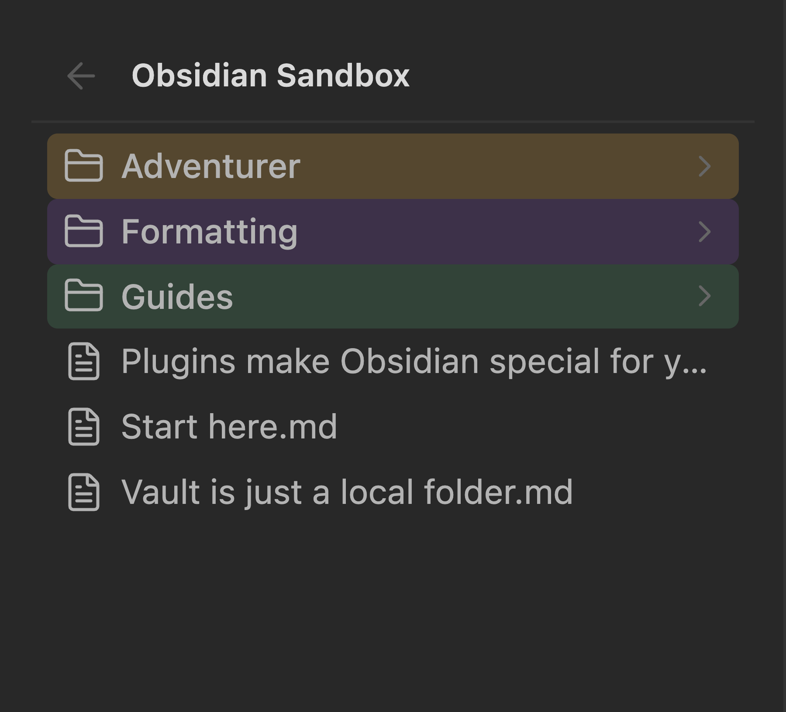
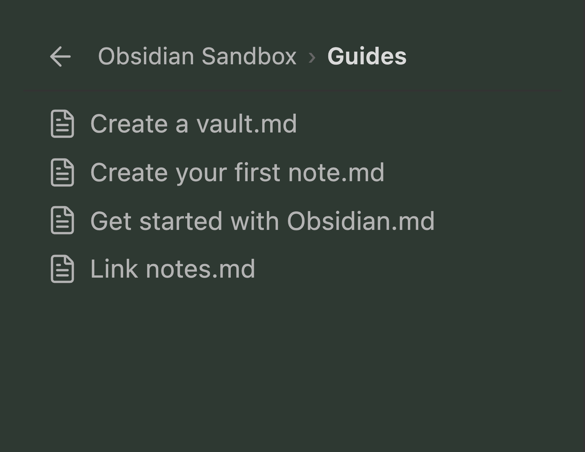

# Folder Nav

**English** · [简体中文](README.zh.md)

An Obsidian plugin that replaces the sidebar file tree with **drill-down navigation** — the sidebar shows one folder at a time, and a breadcrumb walks you back up. Like double-clicking into folders in Windows Explorer or macOS Finder.

No more ever-deepening indentation eating the width of a narrow sidebar.

<p align="center">
  
  
</p>

## Fork identity and migration

This is an independent fork of [Folder Nav](https://github.com/mianfuqu/obsidian-folder-nav).
Starting with `0.2.5`, its plugin ID is **`folder-nav-ooeooo`**. From `0.2.7`, its display
name is **Folder Nav**. Obsidian uses the independent plugin ID to identify it
separately from the community-listed `folder-nav`, even though their display
names match, so upstream updates will not replace this fork.
Get future updates from [this repository's Releases](https://github.com/Obsidian-Projects/obsidian-folder-nav/releases).

1. Disable the old Folder Nav. To retain settings, first back up
   `.obsidian/plugins/folder-nav/data.json`, if it exists.
2. Uninstall the old plugin or move its whole `folder-nav` directory outside
   `.obsidian/plugins/`. Disabling it alone may still leave upstream update notices.
3. Extract the new ZIP into `.obsidian/plugins/folder-nav-ooeooo/`.
   Copy the backed-up `data.json` into this new directory if needed.
4. Restart Obsidian and enable **Folder Nav**. Rebind any old plugin
   hotkeys, since the command IDs now use the fork's plugin ID.

Keep only one of these plugins enabled, as both replace the native file explorer.
`versions.json` lists only releases using the new ID; older releases remain in history.

For updates within this fork, quit Obsidian completely, replace **all three** files
(`main.js`, `manifest.json`, `styles.css`) in `.obsidian/plugins/folder-nav-ooeooo/`,
and reopen Obsidian. Keep `data.json` to retain your settings. If the settings
sidebar still says `Folder Nav (ooeooo)`, check that this directory's
`manifest.json` has `"name": "Folder Nav"` and restart the app; replacing only
`main.js` or toggling the plugin can leave the old name in memory.

## Why

Obsidian's file explorer indents every level. By the third or fourth level — `Notes › Course › Week 3 › Handout.pdf` — the names are squeezed into a sliver, and the whole tree is always on screen competing for attention.

Folder Nav keeps the sidebar at a constant depth. You see the folder you're standing in, and the breadcrumb tells you where that is.

## Usage

Enabled by default: it takes over the built-in **Files** view. The sidebar tab is unchanged, and so is the ribbon icon.

The header has two rows: a responsive path above **Back / Forward / Parent / Vault root**.
The vault root is a home icon; its full name remains in the tooltip and path menu.
Both rows fill the available sidebar width. The path is left-aligned: each segment
uses its text width, stays next to its neighbours, and shrinks only when necessary.
The four toolbar buttons share the second row equally.
Nearby levels stay visible while distant ancestors collapse into `…`. Open it for a
full-path menu that can extend beyond the sidebar, wrap long names, and jump to any
ancestor. The path refits when the sidebar width, font size, or theme font changes.

**Mouse**

| Action | Result |
| --- | --- |
| Click a folder | Go into it |
| Click a file | Open it in the main editor area (never in the sidebar) |
| Click a breadcrumb segment | Jump back to that level |
| Click `←` / `→` | Go back / forward in visit history |
| Click `↑` / the home button | Go to the parent / vault root |
| Right-click a file or folder | **New note** / **New folder**, **Rename**, **Move to…**, **Make a copy**, **Delete** — plus other plugins' menu items |

> Obsidian adds its core context-menu items inside the file explorer's own code, *before* it fires the `file-menu` event — so a plugin listening to that event only ever sees third-party contributions. Since Folder Nav replaces that view, it rebuilds the core items itself on public API. **Delete** in particular hands off to Obsidian's own `promptForDeletion`, so your "confirm before deleting" setting is respected.

**Keyboard** (click the list first)

| Key | Action |
| --- | --- |
| `↑` / `↓` | Move the selection |
| `Enter` | Open the selection |
| `Backspace` / `Alt+←` / `Cmd/Ctrl+[` | History back |
| `Shift+Backspace` / `Alt+→` / `Cmd/Ctrl+]` | History forward |
| `Alt+↑` | Parent folder |
| `Esc` | Clear the selection |

Navigating somewhere new after going back discards the old forward branch; repeated
visits to the current location do not add history. The path menu supports arrows,
Home/End, Enter, and Escape with focus restoration.

The current folder, back/forward history, selection, and list scroll position are
saved in the plugin's `data.json` and restored when the navigation view reopens,
including after restarting Obsidian. If a saved folder no longer exists, the
nearest existing parent is opened. With auto-reveal enabled, switching notes can
subsequently move the view to the active note's folder.

**Commands** (also bindable in Settings → Hotkeys)

- `Folder Nav: Toggle drill-down / native file list`
- `Folder Nav: Go to vault root`
- `Folder Nav: Go up one level`
- `Folder Nav: Back to previous directory`
- `Folder Nav: Forward in directory history`
- `Folder Nav: Reveal current file in list`

## Folder colours

Give a folder a colour and it carries into everything below it: the row is tinted where it sits, and the whole sidebar picks up a wash once you're inside. A drill-down list never shows you the parent folder, so the colour is what tells you where you are.

<p align="center">
  
  
</p>

**Set one** — right-click a folder → **Folder colour**, then pick a swatch. A folder with no colour of its own inherits the nearest coloured ancestor, so drilling deeper keeps the cue.

**Manage them** — Settings → Folder Nav → Folder colours lists every coloured folder, with a **Background intensity** slider. At `0` only the folder row is tinted and the list background is left alone.

Manual colors apply to folder icons and translucent backgrounds; text follows the
theme. Theme hover and selection backgrounds take precedence over manual row tinting.
Clear a manual color to resume the theme's automatic colors.

## Settings

| Setting | Description |
| --- | --- |
| **Path font size** | Follow the theme by default, or choose 12–22px with live preview. Reset restores theme inheritance. |
| **File-list font size** | Independent of the path, with the same theme/custom modes and 12–22px range. Wrapping names grow the row height. |
| **Background intensity** | How strong the wash is inside a coloured folder — the number is the opacity percentage. `0` tints the folder row only. |
| **Take over the file list** | Turn off to restore the native tree instantly — nothing is left behind. |
| **Sort order** | *Follow native* mirrors the sort the built-in explorer was using when Folder Nav took over (alphabetical, modified time, …). *Folders first* always puts folders above files, then sorts by name. |
| **Reveal current file** | Follow the active note into its folder. Seeded from Obsidian's own "Auto reveal" setting. |
| **Show file extensions** | Off shows `Note` instead of `Note.md`. |
| **Hide loose files in the vault root** | Only affects the vault root — handy when attachments pile up there. |
| **Hidden extensions** | Comma-separated list used by the setting above. |

## Border and Style Settings

The following **Components → File explorer** switches control the view directly:

| Border option | Behavior |
| --- | --- |
| **Bold folder font** | Updates folder name weight immediately. |
| **Remove custom icon** | Hides extra list icons and disables rainbow icons; toolbar buttons and folder-entry arrows stay available. |
| **Enable colorful folder icon** | Uses Border's eight theme colors and cycle. Full sibling positions remain stable across navigation and root-file filtering. |
| **Untrim file names** | Wraps long file and folder names in the list; the header retains its single-line folding behavior. |

Theme navigation variables supply default font sizes. A custom size overrides only
its own region; Reset resumes inheritance. Appearance updates retain existing list
nodes, while resize observation refits the path. Other themes use Obsidian's generic
navigation variables; native-tree-only controls are outside these four adapters.

## How it works

Folder Nav replaces the *view* inside the existing file-explorer leaf rather than disabling Obsidian's core file-explorer plugin. Disabling that plugin would also remove the sidebar's ribbon icon, and reaching for it would mean touching undocumented APIs. Everything here goes through the public workspace API — the plugin makes no use of `app.internalPlugins` or any other private surface.

The replacement is re-applied on `layout-change`, so the built-in plugin recreating its leaf (on layout restore, or when you run "Open file explorer") doesn't leave you with a native tree. Duplicate drill-down leaves are collapsed down to one.

Nothing in your vault configuration is rewritten. `workspace.json` and `core-plugins.json` are never modified by the plugin.

## Limitations

- **No drag-and-drop to move files.** Obsidian's native drag handling is bound to its own explorer internals; reusing it means depending on undocumented APIs. Use the context menu's **Move to…** instead, which opens a folder picker.
- **No inline rename (F2) and no multi-select.** **Rename** lives in the context menu and opens a small dialog. Select one file at a time.
- **Custom folder order isn't reproduced.** Sorting is computed from your chosen order rather than borrowed from the built-in explorer, which is destroyed on takeover. Folders you manually reordered with another plugin will sort by name or date instead.
- **Obsidian's own "Reveal file in navigation" does nothing while the takeover is on.** It targets the built-in explorer's view, which is no longer loaded, so it quietly no-ops — it won't open a second file list or throw. Use **Folder Nav: Reveal current file in list** instead, and rebind your hotkey to it if you had one on the built-in command.
- **A major Obsidian update may still require fixes.** The takeover is built on the public workspace API, but it does replace a core view, which no API promises to keep working. The failure mode is safe by design: if the takeover can't run, you get the native file list back.
- **Desktop and mobile.** `isDesktopOnly` is off, but the drill-down layout has mainly been exercised on desktop.

## Development

```bash
npm ci
npm run check     # TypeScript typecheck
npm test          # Node's built-in regression tests
npm run build     # typecheck + bundle
npm run dev       # watch mode
```

Development requires Node.js 18 or newer. The toolchain has three direct
dependencies: TypeScript, esbuild, and the official Obsidian API types. ESLint
and its Obsidian rules are no longer installed; type checking and behavior tests
are separate checks. The shipped plugin only imports Obsidian at runtime.

The list reuses existing rows and SVG icons, delegates row events to the view,
and batches vault events into one refresh per animation frame. Keyboard
selection updates only the old and new rows. Root-file filtering runs before
sorting and reuses its parsed extension list. Tests cover DOM allocations and
event bursts using a DOM double, plus actual production and watch builds;
they do not measure browser layout or replace testing in Obsidian.

`main.js` is written to the project root. To also copy it into a vault while developing:

```bash
OBSIDIAN_PLUGIN_DIR=~/MyVault/.obsidian/plugins/folder-nav-ooeooo npm run build
```

Watch mode copies each successful rebuild to that directory too. Production
builds omit timestamps so unchanged sources produce identical bundles.

Debug loop, if you have the Obsidian CLI:

```bash
obsidian vault=MyVault plugin:reload id=folder-nav-ooeooo
obsidian vault=MyVault dev:errors
obsidian vault=MyVault dev:screenshot path=/tmp/shot.png
```

### Automated GitHub releases

Commit the `.github/` directory and these changes to the repository. Increasing
`manifest.json`'s `version` and pushing to the default branch runs the
`Release Obsidian plugin` workflow: locked install, regression tests, build,
then a matching tag and Release, such as `0.2.4` without a `v` prefix.
Description-only edits skip publishing; version downgrades fail. The plugin's
manifest is the version source, independent of `package.json`.

Each Release includes `main.js`, `manifest.json`, `styles.css`, an installable
`folder-nav-ooeooo-VERSION.zip`, and `SHA256SUMS.txt`. Assets upload to a draft before
publication. Rerunning does not replace a published Release. A manual run from
Actions can publish the current version on the default branch.

The workflow uses the built-in `GITHUB_TOKEN`; no personal token is needed.
Enable Actions and allow the workflow's `contents: write` permission under
your repository or organization policies. Add each new plugin version and its
minimum Obsidian version to `versions.json` so older clients can find compatible
historical releases.

### Source layout

```
src/
├── main.ts       Plugin entry: lifecycle, commands, settings wiring
├── view.ts       FolderNavView — navigation state, history, list rendering
├── takeover.ts   Swap the built-in explorer's view for ours, and back
├── breadcrumb.ts Breadcrumb trail construction
├── pathMenu.ts   Full-path menu, keyboard navigation and focus restoration
├── border.ts     Cached Border palette mapping from full sibling positions
├── config.ts     Validated settings and defaults
├── paths.ts      Path boundaries and rename rebasing
├── render.ts     A single list row
├── palette.ts    Folder colour palette and nearest-ancestor lookup
├── colorPicker.ts Colour swatch modal
├── sort.ts       Sorting and the vault-root filter
└── settings.ts   Settings tab
```

## Contributors

- **mianfuqu** — original author
- **ooeooo** — fork maintainer
- **[DeepSeek](https://www.deepseek.com/)** — implementation

See [CONTRIBUTORS.md](CONTRIBUTORS.md).

## License

MIT
